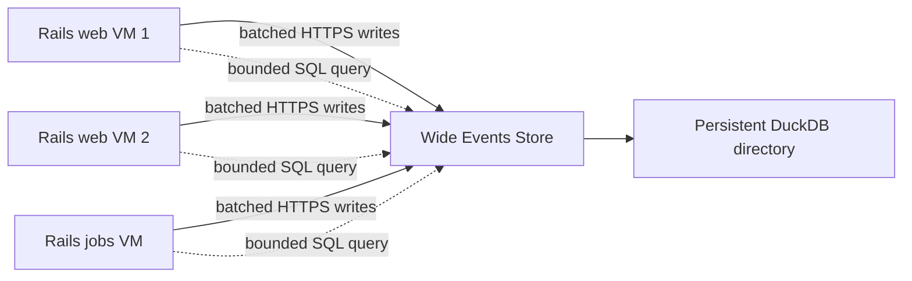

# Wide Events DuckDB Store Design

**Date:** 2026-08-05

**Status:** Approved design

**Scope:** A default, self-hosted, SQL-queryable telemetry store for multi-host Rails applications deployed with Kamal

## Summary

Wide Events will ship with an optional companion service that makes production
telemetry queryable without an observability SaaS subscription. Every Rails web
and job process sends completed wide events over HTTPS to one networked storage
service. That service is the only process that opens a native DuckDB database
file. Any authorized Rails host or operator can query the combined dataset over
the same HTTPS endpoint.

The default deployment is one version-pinned `wide-events-store` container, one
persistent directory, and one telemetry hostname managed as a Kamal accessory.
The Rails gem performs capture, buffering, delivery, and query-client duties.
The store performs authenticated ingestion, single-writer persistence, bounded
read-only SQL, retention, checkpointing, and local backups.

DuckLake and direct S3/Parquet storage are intentionally not part of v1. They
remain possible future backends behind the same client/store boundary.

## Product Promise

A Rails team with an SSH-reachable VM and control of its DNS should be able to:

1. Add the gem.
2. Run the install generator and Wide Events setup skill.
3. Add one DNS record for the telemetry hostname.
4. Run `kamal setup`.
5. capture requests and jobs from every application host; and
6. run useful production SQL within five to ten minutes of hands-on setup.

DNS propagation and provisioning a new VM are external waiting time and are not
included in the five-to-ten-minute hands-on target. No OpenTelemetry backend,
ClickHouse, HyperDX, SigNoz, or paid observability vendor is required. The user
continues to pay only for infrastructure and DNS they control.

## Goals

- Combine telemetry from horizontally scaled web and job hosts into one dataset.
- Preserve the existing one-request-or-job-per-row wide-event model.
- Make common Rails questions readable as ordinary SQL.
- Keep telemetry completely out of the application request critical path.
- Keep telemetry failures from raising into application code.
- Require no OpenTelemetry installation for direct storage.
- Make Kamal 2 the blessed production setup path.
- Use public HTTPS with automatic certificate management as the default network
  boundary.
- Keep installation deterministic and usable without an AI agent.
- Keep the stored data and query engine under the application's ownership.

## Non-goals

- High availability for the storage service in v1.
- Zero-loss delivery during a prolonged store outage or Rails process crash.
- A dashboard or trace-waterfall user interface.
- General-purpose remote DuckDB hosting.
- Arbitrary mutating SQL over HTTP.
- Automatic DNS-provider integration.
- DuckLake, an S3 data lake, or cross-region replication in v1.
- Replacing the existing OpenTelemetry and JSON log sinks.

## Architecture



The DuckDB file is never mounted or shared across application VMs. The store is
a network service, but DuckDB remains embedded inside that one service process.
This preserves DuckDB's supported single-process read/write model while allowing
any number of Rails clients.

The store is a single point of ingestion and query availability. That is an
explicit v1 tradeoff. If it is unavailable, Rails requests continue normally,
clients buffer within fixed limits, and queries fail clearly until it returns.

## Deployment Convention

The blessed v1 deployment uses:

- one public hostname such as `telemetry.example.com`;
- an `A` or `AAAA` record pointing to the store VM;
- Kamal Proxy for TLS termination and Let's Encrypt certificate management;
- no direct public mapping of the store's application port;
- one persistent host directory mounted into the store container; and
- separate ingest and query tokens supplied through Kamal secrets.

A private URL remains a manual escape hatch for deployments with a trusted
cross-host network. It is not the primary generated path.

An illustrative Kamal 2 configuration is:

```yaml
env:
  clear:
    WIDE_EVENTS_URL: https://telemetry.example.com
    WIDE_EVENTS_SERVICE: myapp
    WIDE_EVENTS_ENVIRONMENT: production
  secret:
    - WIDE_EVENTS_INGEST_TOKEN
    - WIDE_EVENTS_QUERY_TOKEN

accessories:
  wide_events:
    image: ghcr.io/adammiribyan/wide-events-store:0.2.0
    host: 203.0.113.20

    proxy:
      host: telemetry.example.com
      ssl: true
      app_port: 7421
      healthcheck:
        path: /up
        interval: 3
        timeout: 3

    env:
      clear:
        WIDE_EVENTS_LISTEN: 0.0.0.0:7421
        WIDE_EVENTS_DATABASE: /var/lib/wide-events/events.duckdb
        WIDE_EVENTS_SERVICE: myapp
        WIDE_EVENTS_ENVIRONMENT: production
        WIDE_EVENTS_RETENTION_DAYS: 30
      secret:
        - WIDE_EVENTS_INGEST_TOKEN
        - WIDE_EVENTS_QUERY_TOKEN

    directories:
      - local: /var/lib/myapp-wide-events
        remote: /var/lib/wide-events
        mode: "0750"
        owner: "1000:1000"

    options:
      restart: always
      cpus: 2
      memory: 2g

aliases:
  telemetry: app exec -i --reuse "bin/rails wide_events:sql"
  wide-events-backup: accessory exec wide_events "wide-events backup"
```

The concrete image version in generated configuration is the current compatible
store release, never `latest`. The example tag is illustrative and changes with
the release.

The query token is available to all app roles by default because the product
requirement is that any Rails host can query the shared dataset. Operators may
remove it from application roles and retain query access only through their
Kamal secret environment if they prefer a narrower trust boundary.

## Components

### Rails gem

The gem gains four bounded components:

1. `Sinks::Store` turns a finished attribute hash into a versioned event
   envelope and hands it to the sender.
2. `Store::Sender` owns the per-process bounded queue, batching, retry loop, and
   shutdown flush.
3. `Store::Client` implements authenticated ingestion, health/version checks,
   and query requests using Ruby's standard HTTP client.
4. Rails generator/tasks provide deterministic installation, setup validation,
   SQL access, and an interactive SQL prompt.

The install generator now installs three bundled agent skills: the existing
instrumentation and debugging skills plus a new
`setting-up-wide-events-store` skill. The existing `wide_events:skills`
generator remains the command for refreshing those installed copies.

The sender starts lazily and records its creating PID. After a Puma or job-worker
fork, the first flush in the child replaces inherited state and starts a fresh
sender thread. No background thread is expected to survive a fork.

When `WIDE_EVENTS_URL` is present, the generated initializer enables the store
sink. The existing OTel sink remains available when explicitly selected, and the
existing JSON log and custom sink contracts remain supported. If no store URL is
present, existing behavior remains backward compatible.

Direct storage adds an explicit total-duration measurement around requests and
jobs because that value currently comes from the enclosing OTel span rather than
the attribute hash. Rails-native route, database-runtime, view-runtime, cache,
job, error, uptime, user-agent, registry, and custom attributes continue to work
without OTel. OTel-derived dependency span counters remain available when the
OTel SDK and instrumentations are installed.

### Store service

The companion service lives under `store/` in this repository and is published
as a multi-architecture OCI image for `amd64` and `arm64`. It is implemented in
Go using the core-team-maintained primary DuckDB Go client. It compiles to a
small standalone service and does not put a native DuckDB dependency into the
Rails application's bundle.

The store pins an exact DuckDB 1.5-or-newer release that supports `VARIANT`; a
store image update is responsible for updating and testing that engine version.
The container runs as uid/gid `1000:1000`, matching the generated persistent
directory ownership.

The service contains:

- an HTTPS-facing HTTP API behind Kamal Proxy;
- a bounded ingestion channel and one writer goroutine;
- one DuckDB database instance with dedicated writer and query connections in
  the same process;
- embedded, monotonic schema migrations;
- a query policy and result streamer;
- scheduled retention, checkpoint, and backup maintenance; and
- a small administrative executable used only through `kamal accessory exec`.

Gem and store versions communicate through a versioned protocol. The store
accepts a documented range of protocol versions and returns an actionable
compatibility error before accepting unsupported payloads.

## Event Envelope and Ingestion Protocol

`POST /v1/events` accepts a gzip-capable JSON batch with this logical shape:

```json
{
  "protocol_version": 1,
  "batch_id": "uuid",
  "events": [
    {
      "id": "uuid",
      "occurred_at": "2026-08-05T12:34:56.789Z",
      "kind": "request",
      "duration_ms": 42.7,
      "deployment": "kamal-version-if-available",
      "source": "container-or-host-identity",
      "attributes": {
        "http.route.controller": "ReportsController#index",
        "http.response.status_code": 200,
        "error": false
      }
    }
  ]
}
```

The store fixes `service` and `environment` from its own configuration rather
than trusting the client. It sets `received_at` at commit time. Retention uses
`received_at`, so a client with a bad clock cannot bypass or immediately trigger
retention. `occurred_at` remains the default analytical time axis.

The server validates protocol version, batch and event counts, primitive
attribute values, timestamps, UUIDs, and body size before enqueueing. A request
contains at most 500 events, an event contains at most 256 attributes and 64 KiB
of uncompressed JSON, and the compressed request body is at most 2 MiB. Invalid
batches are rejected atomically.

The writer commits a complete batch in one DuckDB transaction and acknowledges
only after commit. It records the `batch_id` in a compact ingestion ledger in the
same transaction. Retrying a committed batch returns success without inserting
duplicate rows. The main event table does not need a per-row uniqueness index.

## Delivery and Backpressure

The default sender configuration is:

- flush after 100 events or one second, whichever comes first;
- retain at most 1,000 queued events per Rails process;
- one-second connect timeout and two-second request timeout;
- exponential retry backoff capped at 30 seconds; and
- a best-effort two-second shutdown flush.

These values are configurable but finite. Application requests only enqueue an
already-sanitized event into memory and never perform network I/O. When the queue
is full, it drops the oldest event, increments a loss counter, and reports a
rate-limited warning through the configured Wide Events error handler or Rails
logger. It never blocks or raises into application work.

HTTP timeouts, `429`, and `5xx` responses retain the current batch for retry.
Permanent `4xx` validation or compatibility failures discard the rejected batch
after reporting the actionable server message. A Rails process crash can lose
its in-memory queue; v1 intentionally does not add a local disk spool.

## Storage Schema and Query Experience

The primary table is append-oriented and has no index. It stores common filters
and measures as typed columns while retaining the complete flat event in a
`VARIANT` object:

```sql
CREATE TABLE wide_events (
  id           UUID NOT NULL,
  occurred_at  TIMESTAMPTZ NOT NULL,
  received_at  TIMESTAMPTZ NOT NULL,
  service      VARCHAR NOT NULL,
  environment  VARCHAR NOT NULL,
  deployment   VARCHAR,
  source       VARCHAR,
  kind         VARCHAR NOT NULL,
  duration_ms  DOUBLE NOT NULL,
  route        VARCHAR,
  job_class    VARCHAR,
  status       INTEGER,
  error        BOOLEAN NOT NULL,
  request_id   VARCHAR,
  attributes   VARIANT NOT NULL
);
```

The writer promotes `route`, `job_class`, `status`, `error`, and `request_id`
from their registered attribute names. The full original sanitized hash remains
in `attributes`, including promoted and custom keys. This avoids migrations for
application attributes and keeps the registry as the application-facing schema.

Common queries use ordinary columns:

```sql
SELECT
  route,
  count(*) AS requests,
  quantile_cont(duration_ms, 0.95) AS p95_ms
FROM wide_events
WHERE occurred_at > current_timestamp - INTERVAL '1 day'
GROUP BY route
ORDER BY p95_ms DESC;
```

Custom attributes preserve their types and use DuckDB's variant extraction:

```sql
SELECT
  variant_extract(attributes, 'report.format')::VARCHAR AS format,
  avg(duration_ms)
FROM wide_events
GROUP BY format;
```

`bin/rails wide_events:sql` supports an interactive prompt and stdin. Query
results support terminal-table, JSON, and CSV formats. The debugging skill is
updated with store-native standing queries while retaining ClickHouse and log
guidance for existing deployments.

## Privacy and Tenancy

One v1 store represents one configured service and environment. It is not a
multi-tenant observability service, and clients cannot choose a different
service or environment in their payloads.

The existing registry, strict-mode, sanitization, value-length, and PII-review
workflow remains the application-side privacy boundary. Wide Events does not
automatically capture request parameters, bodies, or arbitrary application
objects. The store persists exactly the sanitized primitive attributes it
receives and does not attempt a second anonymization policy. Existing fields
such as `exception.message` retain their registry warning and length cap.

## Query API and Security

The public service exposes only:

- `POST /v1/events`, authenticated with the ingest token;
- `POST /v1/query`, authenticated with the query token; and
- `GET /up`, unauthenticated and limited to availability and store version.

There is no HTTP endpoint for backup, maintenance, migration, shutdown, file
download, or arbitrary administration.

Tokens contain at least 256 bits of random entropy, are compared in constant
time, and are never written to request logs. TLS is mandatory for a public URL.
The HTTP server allows at most 20 concurrent ingestion requests and keeps at
most 100 accepted batches in its writer channel; excess requests receive `429`
without unbounded allocation.

The query API accepts exactly one statement. The store asks DuckDB for the
prepared statement type and permits only non-mutating query forms equivalent to
`SELECT`, read-only `WITH`, `EXPLAIN`, `SHOW`, and `DESCRIBE`. It rejects `COPY`,
`ATTACH`, `INSTALL`, `LOAD`, `SET`, `PRAGMA`, DDL, DML, multi-statements, and any
statement whose type cannot be proven read-only.

All query connections share these locked startup settings:

- external access disabled;
- extension installation and loading disabled;
- community extensions disabled;
- configuration locked after service initialization;
- memory below the container limit; and
- a bounded temporary directory inside the persistent mount.

The default query policy allows one concurrent query, 15 seconds of execution,
10,000 returned rows, and a 10 MiB response. Excess work is cancelled and
reported as a query-limit error. Configuration can raise these limits, but
cannot remove the read-only statement policy. Query logs contain duration, row
count, result bytes, status, and a query hash, not raw SQL by default.

## Retention, Checkpointing, and Backups

Retention defaults to 30 days and is configurable by whole days. A daily
maintenance gate drains committed ingestion work, pauses new writer
transactions, deletes rows whose `received_at` is outside retention, and runs a
DuckDB checkpoint. Since events arrive approximately in timestamp order, expired
rows cluster in older row groups and are eligible for space reclamation during
checkpointing.

The same maintenance gate creates one automatic local backup per day under
`/var/lib/wide-events/backups/` and retains the three most recent backups by
default. A backup drains the writer, checkpoints the database, creates a
consistent timestamped DuckDB copy through DuckDB's database-copy facility,
verifies that the copy can be opened and queried, then resumes writes. Clients
buffer or receive a retryable response while the gate is closed. Query requests
receive `503` while the exclusive backup operation runs.

`kamal wide-events-backup` invokes the same operation inside the accessory over
Kamal's SSH path. It is an operator convenience for pre-upgrade snapshots, not a
public endpoint. Local backups protect against logical mistakes and a bad store
upgrade but not loss of the storage VM or volume. Optional S3 upload may be added
later or configured manually; it is not required for v1.

## Installation and Setup Skill

The human-visible workflow is:

```bash
bundle add wide_events
bin/rails generate wide_events:install
# Ask the agent to run the installed Wide Events setup skill.
kamal setup
kamal telemetry
```

The setup skill asks for only:

1. the SSH address of the chosen store VM;
2. the telemetry hostname; and
3. retention days, defaulting to 30.

The `setting-up-wide-events-store` skill delegates deterministic changes to
generator/task code. The tooling:

- installs the initializer, registry, test helper, and all three agent skills;
- adds the store accessory, application environment, persistent directory, and
  Kamal aliases;
- pins a compatible store image;
- generates stable ingest and query tokens into the gitignored files
  `.kamal/wide-events-ingest-token` and `.kamal/wide-events-query-token`;
- references those files from `.kamal/secrets` without regenerating tokens on
  every Kamal invocation;
- prints the exact DNS record to create and waits for it to resolve correctly;
- runs `kamal config` before deployment; and
- remains idempotent on repeat runs.

For the standard Rails 8/Kamal 2 layout, the generator edits
`config/deploy.yml` in place with marked additions. If the file is structurally
ambiguous, already defines conflicting keys, or cannot be changed without
discarding comments/ERB, the generator must stop without partial edits and emit
a complete mergeable snippet. The setup skill may perform the context-specific
merge, followed by mandatory `kamal config` validation. Core setup never depends
on an agent silently making an unverifiable YAML rewrite.

After `kamal setup`, verification:

1. checks `/up` and protocol compatibility;
2. sends a synthetic event and queries it back;
3. asks the user to exercise one real Rails route;
4. queries and displays that captured row; and
5. prints a route count and p95-latency query.

## Versioning and Upgrades

The gem and store use an explicit integer protocol version independent of gem
and image semantic versions. Generated configuration pins the store image.
Normal application deploys do not silently upgrade the accessory.

The store runs monotonic migrations before marking itself ready. An upgrade
workflow creates and verifies a backup first, reboots the accessory with the new
image, waits for readiness, then performs the synthetic write/read check. The
old image and verified backup remain available for rollback instructions.

## Testing Strategy

### Rails gem

- Existing Rails 7.1 through main and Ruby 3.2 through current matrices remain.
- Store sink envelope formation and promoted fields.
- Batch thresholds, gzip, retries, permanent failures, and overflow dropping.
- No request-thread network calls.
- Sender lifecycle across fork and PID change.
- Bounded shutdown flush.
- Query client authentication, formats, timeouts, and errors.
- Generator idempotence and safe refusal on ambiguous Kamal files.
- Existing OTel, log, memory, and custom sink behavior remains compatible.

### Go store

- Authentication separation and constant-time token checks.
- Schema creation and each migration path.
- Atomic batch validation and insert.
- Retry deduplication through the batch ledger.
- Promotion of common fields and preservation of typed custom attributes.
- Query statement classification and a corpus of bypass attempts.
- External access, extension, configuration, timeout, row, and response limits.
- Retention by `received_at`, checkpointing, backup verification, and pruning.
- Crash recovery from the WAL and failure during pre- and post-commit windows.

### End to end

- Concurrent simulated clients representing two web hosts and one job host write
  into one store and query one combined result.
- A response lost after commit causes a retry but no duplicate events.
- A store restart preserves committed data and accepts buffered client work.
- A prolonged outage fills a client queue, drops oldest-first, reports loss, and
  never changes the simulated Rails response.
- The generated Kamal fixture passes `kamal config` for supported Kamal 2.
- Both `amd64` and `arm64` images boot, migrate, ingest, query, and back up.

## Acceptance Criteria

The feature is ready for its first release when:

1. Three independent Rails processes on separate hosts can write and query one
   combined dataset through the public endpoint.
2. A Rails request performs no store network I/O and cannot fail because of a
   store error.
3. A committed batch is visible to queries and retrying it produces no duplicate
   rows.
4. Common route, status, job, latency, error, deployment, and request-id queries
   require no JSON/variant extraction.
5. A registered custom attribute can be queried with its original primitive
   type and without a store migration.
6. Query callers cannot mutate the database, access files or networks, load
   extensions, alter settings, or exceed configured resource bounds.
7. Restarting or upgrading the store preserves committed events on the mounted
   directory.
8. Retention, checkpointing, automatic local backups, and private on-demand
   backup work without an HTTP administration endpoint.
9. The generated standard Kamal configuration validates and the post-deploy
   synthetic write/read check succeeds.
10. Existing Wide Events OTel and log deployments remain backward compatible.

## Explicit Tradeoffs and Risks

- **Single store availability:** writes and queries pause when the store is down.
  The Rails application remains available, and this is preferable to adding a
  distributed catalog in v1.
- **Best-effort client memory:** a Rails process crash or long outage can lose
  queued telemetry. A durable client spool is deferred.
- **Public query surface:** strong tokens, TLS, strict statement classification,
  disabled external access, and resource bounds are mandatory. Supplying the
  query token to all app hosts intentionally trusts those hosts with telemetry
  reads.
- **One DNS record:** the default is not zero-DNS setup. This ordinary explicit
  step is preferred to maintaining private certificate pinning or undocumented
  IP-certificate behavior.
- **Local backups share a failure domain:** they do not survive loss of the VM or
  volume. Remote backup is optional, not implied.
- **Go in a Ruby repository:** the additional language is justified by DuckDB's
  core-team-maintained primary Go client and the operational value of a small
  standalone image; the Ruby DuckDB client is not placed in user applications.

## Future Extensions

The v1 API boundary intentionally permits later storage implementations:

- DuckLake with a PostgreSQL catalog and S3-compatible object storage for
  multiple store writers and stronger availability;
- catalogless Parquet export to S3 for cheap long-term archives;
- durable per-host spooling;
- remote backup targets;
- multiple service/environment namespaces with token-scoped access; and
- a lightweight browser query interface.

None of these are prerequisites for the v1 product promise.
