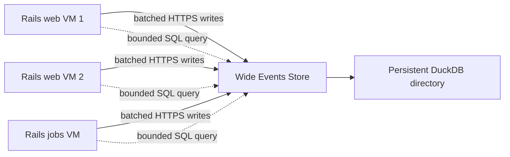

# Wide Events DuckDB Store Design

**Date:** 2026-08-05

**Status:** Approved design

**Scope:** A default, self-hosted, SQL-queryable telemetry store for multi-host Rails applications deployed with Kamal

## Summary

Wide Events will ship with an optional companion service that makes production
telemetry queryable without an observability SaaS subscription. Every Rails web
and job process sends completed wide events over HTTPS to one networked storage
service. That service is the only process that opens a native DuckDB database
file. Any authorized Rails host or operator can query the combined dataset over
the same HTTPS endpoint.

The default deployment is one version-pinned `wide-events-store` container, one
persistent directory, and one telemetry hostname managed as a Kamal accessory.
The Rails gem performs capture, buffering, delivery, and query-client duties.
The store performs authenticated ingestion, single-writer persistence, bounded
read-only SQL, retention, checkpointing, and local backups.

DuckLake and direct S3/Parquet storage are intentionally not part of v1. They
remain possible future backends behind the same client/store boundary.

## Product Promise

A Rails team with an SSH-reachable VM and control of its DNS should be able to:

1. Add the gem.
2. Run the install generator and Wide Events setup skill.
3. Add one DNS record for the telemetry hostname.
4. Run `kamal setup`.
5. capture requests and jobs from every application host; and
6. run useful production SQL within five to ten minutes of hands-on setup.

DNS propagation and provisioning a new VM are external waiting time and are not
included in the five-to-ten-minute hands-on target. No OpenTelemetry backend,
ClickHouse, HyperDX, SigNoz, or paid observability vendor is required. The user
continues to pay only for infrastructure and DNS they control.

## Goals

- Combine telemetry from horizontally scaled web and job hosts into one dataset.
- Preserve the existing one-request-or-job-per-row wide-event model.
- Make common Rails questions readable as ordinary SQL.
- Keep telemetry completely out of the application request critical path.
- Keep telemetry failures from raising into application code.
- Require no OpenTelemetry installation for direct storage.
- Make Kamal 2.10.0 or newer the blessed production setup path.
- Use public HTTPS with automatic certificate management as the default network
  boundary.
- Keep installation deterministic and usable without an AI agent.
- Keep the stored data and query engine under the application's ownership.

## Non-goals

- High availability for the storage service in v1.
- Zero-loss delivery during a prolonged store outage or Rails process crash.
- A dashboard or trace-waterfall user interface.
- General-purpose remote DuckDB hosting.
- Arbitrary mutating SQL over HTTP.
- Automatic DNS-provider integration.
- DuckLake, an S3 data lake, or cross-region replication in v1.
- Replacing the existing OpenTelemetry and JSON log sinks.

## Architecture



The DuckDB file is never mounted or shared across application VMs. The store is
a network service, but DuckDB remains embedded inside that one service process.
This preserves DuckDB's supported single-process read/write model while allowing
any number of Rails clients.

The store is a single point of ingestion and query availability. That is an
explicit v1 tradeoff. If it is unavailable, Rails requests continue normally,
clients buffer within fixed limits, and queries fail clearly until it returns.

## Deployment Convention

The blessed v1 deployment uses:

- one public hostname such as `telemetry.example.com`;
- an `A` or `AAAA` record pointing to the store VM;
- Kamal Proxy for TLS termination and Let's Encrypt certificate management;
- no direct public mapping of the store's application port;
- one persistent host directory mounted into the store container; and
- separate ingest and query tokens supplied through Kamal secrets.

A private URL remains a manual escape hatch for deployments with a trusted
cross-host network. It is not the primary generated path.

An illustrative Kamal 2 configuration is:

```yaml
minimum_version: 2.10.0

env:
  clear:
    WIDE_EVENTS_URL: https://telemetry.example.com
    WIDE_EVENTS_SERVICE: myapp
    WIDE_EVENTS_ENVIRONMENT: production
  secret:
    - WIDE_EVENTS_INGEST_TOKEN
    - WIDE_EVENTS_QUERY_TOKEN

accessories:
  wide_events:
    image: ghcr.io/adammiribyan/wide-events-store:0.2.0
    host: 203.0.113.20

    proxy:
      host: telemetry.example.com
      ssl: true
      app_port: 7421
      healthcheck:
        path: /up
        interval: 3
        timeout: 3

    env:
      clear:
        WIDE_EVENTS_LISTEN: 0.0.0.0:7421
        WIDE_EVENTS_DATABASE: /var/lib/wide-events/events.duckdb
        WIDE_EVENTS_SERVICE: myapp
        WIDE_EVENTS_ENVIRONMENT: production
        WIDE_EVENTS_RETENTION_DAYS: 30
      secret:
        - WIDE_EVENTS_INGEST_TOKEN
        - WIDE_EVENTS_QUERY_TOKEN

    directories:
      - local: /var/lib/myapp-wide-events
        remote: /var/lib/wide-events
        mode: "0750"
        owner: "1000:1000"

    options:
      cpus: 2
      memory: 2g

aliases:
  telemetry: app exec -i --reuse "bin/rails wide_events:sql"
  wide-events-backup: accessory exec wide_events "wide-events admin backup"
```

The concrete image version in generated configuration is the current compatible
store release, never `latest`. The example tag is illustrative and changes with
the release. The generated configuration requires Kamal 2.10.0 or newer. Kamal
2.4.0 introduced accessory proxying and proxy health checks, while 2.10.0 added
the structured accessory-directory ownership and permissions used above. The
generator sets Kamal's root `minimum_version` key so incompatible deploys fail
before touching a server; it never lowers a higher minimum already configured.
Kamal itself applies the required `unless-stopped` restart policy to accessories,
so generated `options` do not attempt to override it.

The query token is available to all app roles by default because the product
requirement is that any Rails host can query the shared dataset. Operators may
remove it from application roles and retain query access only through their
Kamal secret environment if they prefer a narrower trust boundary.

## Components

### Rails gem

The gem gains four bounded components:

1. `WideEvent::Sinks::Store` turns a finished attribute hash into a versioned event
   envelope and hands it to the sender.
2. `WideEvent::Store::Sender` owns the per-process bounded queue, batching,
   retry loop, and shutdown flush.
3. `WideEvent::Store::Client` implements authenticated ingestion,
   health/version checks, and query requests using Ruby's standard HTTP client.
4. Rails generator/tasks provide deterministic installation, setup validation,
   SQL access, and an interactive SQL prompt.

Runtime code follows the gem's existing singular `WideEvent` namespace. Only
Rails generator classes retain the existing `WideEvents::Generators` namespace;
the plural gem name, commands, and environment-variable prefix are intentional.

The install generator now installs three bundled agent skills: the existing
instrumentation and debugging skills plus a new
`setting-up-wide-events-store` skill. The existing `wide_events:skills`
generator remains the command for refreshing those installed copies.

The sender starts lazily and records its creating PID. Every enqueue compares
the current PID with the recorded PID. On a mismatch after a Puma or job-worker
fork, it discards inherited queue, socket, and thread references, creates a new
child-local sender, and only then enqueues the event. No background thread is
expected to survive a fork.

When `WIDE_EVENTS_URL` is present, the generated initializer enables the store
sink. The existing OTel sink remains available when explicitly selected, and the
existing JSON log and custom sink contracts remain supported. If no store URL is
present, existing behavior remains backward compatible.

Direct storage adds an explicit total-duration measurement around requests and
jobs because that value currently comes from the enclosing OTel span rather than
the attribute hash. Rails-native route, database-runtime, view-runtime, cache,
job, error, uptime, user-agent, registry, and custom attributes continue to work
without OTel. OTel-derived dependency span counters remain available when the
OTel SDK and instrumentations are installed.

### Store service

The companion service lives under `store/` in this repository and is published
as a multi-architecture OCI image for `amd64` and `arm64`. It is implemented in
Go using the core-team-maintained primary DuckDB Go client. It compiles to a
small standalone service and does not put a native DuckDB dependency into the
Rails application's bundle.

The first store image pins DuckDB 1.5.5 exactly. A store image update is
responsible for deliberately updating and compatibility-testing that engine
version, including every documented `VARIANT` query. The container runs as
uid/gid `1000:1000`, matching the generated persistent directory ownership.

The service contains:

- an HTTPS-facing HTTP API behind Kamal Proxy;
- a bounded ingestion channel and one writer goroutine;
- one DuckDB database instance with dedicated writer and query connections in
  the same process;
- embedded, monotonic schema migrations;
- a query policy and result streamer;
- scheduled retention, checkpoint, and backup maintenance; and
- a local Unix-domain administrative socket plus a small administrative
  executable used only through `kamal accessory exec`.

The service process listens on `/run/wide-events/admin.sock`, owned by uid/gid
`1000:1000` with mode `0600`. The administrative executable connects to that
socket from inside the running container and asks the owning service process to
enter its maintenance gate. The socket is not mounted, published, or proxied,
and there is no network administration API. This preserves the rule that only
the service process opens the DuckDB database.

Gem and store versions communicate through a versioned protocol. The store
accepts a documented range of protocol versions and returns an actionable
compatibility error before accepting unsupported payloads.

## Event Envelope and Ingestion Protocol

`POST /v1/events` accepts a gzip-capable JSON batch with this logical shape:

```json
{
  "protocol_version": 1,
  "batch_id": "uuid",
  "service": "myapp",
  "environment": "production",
  "dropped_events_since_last_batch": 0,
  "loss_report_id": null,
  "events": [
    {
      "id": "uuid",
      "occurred_at": "2026-08-05T12:34:56.789Z",
      "kind": "request",
      "duration_ms": 42.7,
      "deployment": "kamal-version-if-available",
      "source": "container-or-host-identity",
      "attributes": {
        "http.route.controller": "ReportsController#index",
        "http.response.status_code": 200,
        "error": false
      }
    }
  ]
}
```

The client includes `service` and `environment` to detect configuration drift,
but the store always writes the values from its own configuration. A mismatch
increments a counter, logs the expected and received values, and adds a warning
to the successful batch acknowledgement; the client reports that warning with
rate limiting. It sets `received_at` at commit time. Retention uses
`received_at`, so a client with a bad clock cannot bypass or immediately trigger
retention. `occurred_at` remains the default analytical time axis.

The server validates protocol version, batch and event counts, primitive
attribute values, timestamps, UUIDs, and body size before enqueueing. A request
contains at most 500 events and an event contains at most 256 attributes. The
canonical JSON representation of one event is at most 64 KiB. The compressed
HTTP body is at most 512 KiB and the complete decompressed JSON body is at most
2 MiB. Gzip is expanded through a limiting reader that stops and rejects as soon
as the decompressed cap is crossed; the service never inflates an untrusted body
into an unbounded buffer. Invalid batches are rejected atomically.

The writer commits a complete batch in one DuckDB transaction and acknowledges
only after commit. It records the `batch_id` in a compact ingestion ledger in the
same transaction. Retrying a committed batch returns success without inserting
duplicate rows. The main event table does not need a per-row uniqueness index.
Clients retry a batch for at most 24 hours from its first send. Ledger rows are
retained for seven days and pruned daily, leaving a safety margin beyond the
maximum retry horizon while bounding ledger growth.

The sender includes its accumulated loss count in
`dropped_events_since_last_batch`. A non-zero report has its own
`loss_report_id`; the store records that identifier in a seven-day loss ledger
and increments the operational total only once, even if the report is re-carried
by a new batch. The sender snapshots, but does not decrement, its pending loss
counter when sealing a batch. A successful acknowledgement subtracts only that
snapshot; losses accumulated while the batch was in flight remain pending. If
the carrying batch is discarded after a permanent failure or the 24-hour retry
horizon, its snapshot and `loss_report_id` remain pending and are carried by the
next batch. A process that never reconnects or exits before a later
acknowledgement cannot report its final losses, which is an accepted limitation
of the memory-only v1 sender.

## Delivery and Backpressure

The default sender configuration is:

- flush after 100 events or one second, whichever comes first;
- seal a batch before it exceeds 1 MiB of uncompressed canonical JSON and split
  it further if gzip output would exceed 512 KiB;
- retain at most 1,000 events or 8 MiB of canonical JSON per Rails process,
  whichever limit is reached first;
- one-second connect timeout and two-second request timeout;
- exponential retry backoff capped at 30 seconds; and
- a maximum batch retry age of 24 hours;
- a best-effort two-second shutdown flush.

These values are configurable but finite. Application requests only enqueue an
already-sanitized, size-checked event into memory and never perform network I/O.
When either queue bound is full, it drops the oldest event, increments a loss
counter, and reports a rate-limited warning through the configured Wide Events
error handler or Rails logger. It never blocks or raises into application work.

HTTP timeouts, `429`, `507`, and `5xx` responses retain the current batch for
retry. When a batch reaches the 24-hour retry horizon it is discarded and
reported through the same loss path. Other `4xx` validation or compatibility
failures discard the rejected batch after reporting the actionable server
message. A Rails process crash can lose its in-memory queue; v1 intentionally
does not add a local disk spool.

## Storage Schema and Query Experience

The primary table is append-oriented and has no index. It stores common filters
and measures as typed columns while retaining the complete flat event in a
`VARIANT` object:

```sql
CREATE TABLE wide_events (
  id           UUID NOT NULL,
  occurred_at  TIMESTAMPTZ NOT NULL,
  received_at  TIMESTAMPTZ NOT NULL,
  service      VARCHAR NOT NULL,
  environment  VARCHAR NOT NULL,
  deployment   VARCHAR,
  source       VARCHAR,
  kind         VARCHAR NOT NULL,
  duration_ms  DOUBLE,
  route        VARCHAR,
  job_class    VARCHAR,
  status       INTEGER,
  error        BOOLEAN NOT NULL,
  request_id   VARCHAR,
  attributes   VARIANT NOT NULL
);
```

`duration_ms` is required by validation for the v1 `request` and `job` event
kinds but remains nullable in storage so future instantaneous event kinds do not
require a migration.

The writer promotes `route`, `job_class`, `status`, `error`, and `request_id`
from their registered attribute names. The full original sanitized hash remains
in `attributes`, including promoted and custom keys. This avoids migrations for
application attributes and keeps the registry as the application-facing schema.

Common queries use ordinary columns:

```sql
SELECT
  route,
  count(*) AS requests,
  quantile_cont(duration_ms, 0.95) AS p95_ms
FROM wide_events
WHERE occurred_at > current_timestamp - INTERVAL '1 day'
GROUP BY route
ORDER BY p95_ms DESC;
```

Custom attributes preserve their types and use DuckDB's variant extraction:

```sql
SELECT
  variant_extract(attributes, 'report.format')::VARCHAR AS format,
  avg(duration_ms)
FROM wide_events
GROUP BY format;
```

That exact expression is covered by an engine-compatibility test against the
pinned DuckDB 1.5.5 release; an engine bump cannot ship unless the query corpus
continues to pass.

An authenticated, read-only `wide_events_store_status` relation provides the
operational facts needed to manage a store without a dashboard: rows received
in the last hour and day; oldest and newest `received_at`; database-file and
free-disk bytes; queued ingest bytes; rejected and client-reported dropped
counts; ledger rows; `write_ready` and its degradation reason; last checkpoint,
retention, and backup times; last maintenance and backup errors; and store,
protocol, and DuckDB versions. It is backed by a one-row internal status table
maintained by the service; queries do not gain filesystem or operating-system
access.

`bin/rails wide_events:sql` supports an interactive prompt and stdin. Query
results support terminal-table, JSON, and CSV formats. The debugging skill is
updated with store-native standing queries while retaining ClickHouse and log
guidance for existing deployments.

## Privacy and Tenancy

One v1 store represents one configured service and environment. It is not a
multi-tenant observability service, and clients cannot choose a different
service or environment in their payloads.

The existing registry, strict-mode, sanitization, value-length, and PII-review
workflow remains the application-side privacy boundary. Wide Events does not
automatically capture request parameters, bodies, or arbitrary application
objects. The store persists exactly the sanitized primitive attributes it
receives and does not attempt a second anonymization policy. Existing fields
such as `exception.message` retain their registry warning and length cap.

## Query API and Security

The public service exposes only:

- `POST /v1/events`, authenticated with the ingest token;
- `POST /v1/query`, authenticated with the query token; and
- `GET /up`, unauthenticated and limited to routing health, protocol version,
  `write_ready`, and a machine-readable degradation reason.

`/up` returns `200` whenever the process can accept and routably answer API
requests, including while ingestion is disk-degraded or the temporary backup
gate is closed. Its body reports `write_ready: false` in those states. It returns
`503` only when the database cannot be opened or the service cannot safely
resume normal API service. There is no HTTP endpoint for backup, maintenance,
migration, shutdown, file download, or arbitrary administration.

Tokens contain at least 256 bits of random entropy, are compared in constant
time, and are never written to request logs. TLS is mandatory for a public URL.
The HTTP server allows at most 20 concurrent ingestion requests. After
validation, accepted batches are normalized back to canonical bytes and enter a
writer channel bounded by serialized bytes, 32 MiB by default, rather than by
batch count. Queued batches retain no parsed attribute maps. With the 2 MiB
decompressed-body cap, at most about 40 MiB of decoded request bodies plus 32
MiB of serialized queued batches can be awaiting persistence, before bounded
parser and service overhead. An admission that would cross either bound receives
`429`; it is never accepted into an unbounded allocation.

The query API accepts exactly one statement. The store asks DuckDB for the
prepared statement type and permits only non-mutating query forms equivalent to
`SELECT`, read-only `WITH`, `SHOW`, and `DESCRIBE`. Remote `EXPLAIN` is rejected
in v1 because DuckDB classifies `EXPLAIN ANALYZE DELETE ...` as `EXPLAIN`, so
statement type alone cannot prove the inner operation is read-only. The policy
also rejects `COPY`, `ATTACH`, `INSTALL`, `LOAD`, `SET`, `PRAGMA`, DDL, DML,
multi-statements, and any statement whose type cannot be proven read-only.

All query connections share these locked startup settings:

- external access disabled;
- extension installation and loading disabled;
- community extensions disabled;
- configuration locked after service initialization;
- DuckDB memory limited to 1 GiB inside the 2 GiB container limit; and
- a bounded temporary directory inside the persistent mount.

Temporary query spill is capped at the lesser of 4 GiB or 25% of the volume and
is subject to the same free-disk floor as ingestion. These defaults reserve
container memory for the HTTP layer, byte queues, the Go runtime, and native
allocations outside DuckDB's managed buffer pool.

The default concurrency policy allows two active queries and four waiting
requests. A waiting request is admitted within two seconds or receives `429`
with `Retry-After`; this busy policy is distinct from per-query cancellation.
Once admitted, each query has a 15-second execution deadline, 10,000 returned
rows, and a 10 MiB response cap. Work crossing an execution or result limit is
cancelled and reported as a query-limit error. Configuration can raise these
limits, but cannot remove the read-only statement policy. The Rails CLI retries
a busy response within its default 30-second overall command deadline. Query logs contain
duration, row count, result bytes, status, and a query hash, not raw SQL by
default.

## Retention, Checkpointing, and Backups

Retention defaults to 30 days and is configurable by whole days. A daily
maintenance gate drains committed ingestion work, pauses new writer
transactions, deletes rows whose `received_at` is outside retention, and runs a
DuckDB checkpoint. Since events arrive approximately in timestamp order, expired
rows cluster in older row groups and are eligible for space reclamation during
checkpointing.

DuckDB may retain the database file's high-water size after deletes and reuse
that space for later writes; retention is not a promise that the host file
shrinks every day. The generated guidance recommends a dedicated volume of at
least 10 GiB and at least five times the estimated steady-state live database
size. That covers the live database, three local backups, checkpoint/WAL working
space, and operating headroom.

Before each write transaction and maintenance operation, the service checks a
configurable free-space floor that defaults to the greater of 2 GiB or 10% of
the volume. Below that floor it marks the write path degraded, does not begin new
writes or backups, and returns retryable `507` responses to ingestion; existing
read queries remain available. An actual out-of-space error rolls back the
current transaction, removes any incomplete backup, records the error in
`wide_events_store_status`, and follows the same write-degraded behavior. `/up`
continues to return `200` with `write_ready: false` and a disk-space reason, so
Kamal Proxy continues routing read queries. The setup checker treats
`write_ready: false` as an actionable failure even though routing health is
successful.

The same maintenance gate creates one automatic local backup per day under
`/var/lib/wide-events/backups/` and retains the three most recent backups by
default. Before closing the gate, and again after draining and checkpointing, a
backup requires free bytes greater than or equal to the database-file size plus
the larger of 512 MiB or 10% of that size, while also preserving the generic
free-space floor. If that capacity is unavailable, the automatic backup is
skipped before copying, an operator-visible error with required and available
bytes is logged and stored in `wide_events_store_status`, and existing backups
are left untouched. An on-demand backup returns the same values with a non-zero
exit status.

Once its capacity preflight passes, backup creates a consistent timestamped
DuckDB copy through DuckDB's database-copy facility, verifies that the copy can
be opened and queried, then resumes writes. Clients buffer or receive a
retryable response while the gate is closed. Query requests receive `503` while
the exclusive backup operation runs, while `/up` remains `200` with
`write_ready: false` so the temporary operation does not remove the service from
routing.

`kamal wide-events-backup` runs the administrative executable in the existing
accessory container over Kamal's SSH path. The executable asks the already
running service to perform the operation over `/run/wide-events/admin.sock`; it
never opens DuckDB itself. This is an operator convenience for pre-upgrade
snapshots, not a public endpoint. Local backups protect against logical mistakes
and a bad store upgrade but not loss of the storage VM or volume. Optional S3
upload may be added later or configured manually; it is not required for v1.

## Installation and Setup Skill

The human-visible workflow is:

```bash
bundle add wide_events
bin/rails generate wide_events:install
# Ask the agent to run the installed Wide Events setup skill.
kamal setup
kamal telemetry
```

The setup skill asks for only:

1. the SSH address of the chosen store VM;
2. the telemetry hostname; and
3. retention days, defaulting to 30.

The `setting-up-wide-events-store` skill delegates deterministic changes to
generator/task code. The tooling:

- installs the initializer, registry, test helper, and all three agent skills;
- adds the store accessory, application environment, persistent directory, and
  Kamal aliases;
- pins a compatible store image;
- verifies that the installed Kamal is 2.10.0 or newer and prints an upgrade
  command before making deployment changes when it is too old;
- generates stable ingest and query tokens into the gitignored files
  `.kamal/wide-events-ingest-token` and `.kamal/wide-events-query-token`;
- references those files from `.kamal/secrets` without regenerating tokens on
  every Kamal invocation;
- prints the exact DNS record to create and waits for it to resolve correctly
  for at most 120 seconds;
- runs `kamal config` before deployment; and
- remains idempotent on repeat runs.

Because setting accessory directory ownership requires root access on the store
host, setup preflights creation of the data directory before deployment. A
non-root SSH configuration that cannot create and chown that directory stops
with the exact one-time administrator command needed; it does not boot a store
that will later fail to persist data.

For the standard Rails 8/Kamal 2 layout, the generator edits
`config/deploy.yml` in place with marked additions. If the file is structurally
ambiguous, already defines conflicting keys, or cannot be changed without
discarding comments/ERB, the generator must stop without partial edits and emit
a complete mergeable snippet. The setup skill may perform the context-specific
merge, followed by mandatory `kamal config` validation. Core setup never depends
on an agent silently making an unverifiable YAML rewrite.

If DNS has not resolved after 120 seconds, setup exits cleanly without reverting
the generated configuration and prints
`bin/rails wide_events:setup:check` as the exact idempotent resume command. That
command rechecks Kamal version, configuration, DNS, and the deployed endpoint,
so DNS propagation never leaves the setup process hanging indefinitely.

After `kamal setup`, verification:

1. checks `/up`, protocol compatibility, and `write_ready`;
2. sends a synthetic event and queries it back;
3. asks the user to exercise one real Rails route;
4. queries and displays that captured row; and
5. prints a route count and p95-latency query.

## Versioning and Upgrades

The gem and store use an explicit integer protocol version independent of gem
and image semantic versions. Generated configuration pins the store image.
Normal application deploys do not silently upgrade the accessory.

The store runs monotonic migrations before marking itself ready. An upgrade
workflow creates and verifies a backup first, reboots the accessory with the new
image, waits for readiness, then performs the synthetic write/read check. The
old image and verified backup remain available for rollback instructions.

## Testing Strategy

### Rails gem

- Existing Rails 7.1 through main and Ruby 3.2 through current matrices remain.
- Store sink envelope formation and promoted fields.
- Batch thresholds, gzip, retries, permanent failures, and overflow dropping.
- Compressed and decompressed body caps, gzip expansion attacks, and byte-based
  queue admission under the 2 GiB container budget.
- No request-thread network calls.
- Sender lifecycle across fork and PID change at enqueue time.
- Service/environment drift warnings and retry-ledger horizon behavior.
- Loss counters remain pending until acknowledgement and survive discard of the
  batch that first carried them.
- Bounded shutdown flush.
- Query client authentication, formats, timeouts, and errors.
- Generator idempotence and safe refusal on ambiguous Kamal files.
- Existing OTel, log, memory, and custom sink behavior remains compatible.

### Go store

- Authentication separation and constant-time token checks.
- Schema creation and each migration path.
- Atomic batch validation and insert.
- Retry deduplication through the batch ledger.
- Seven-day batch-ledger pruning after the 24-hour client retry horizon.
- Loss-report deduplication when a discarded batch's pending count is
  re-carried under a new batch ID, plus seven-day loss-ledger pruning.
- Promotion of common fields and preservation of typed custom attributes.
- The documented `variant_extract` query corpus against DuckDB 1.5.5 exactly.
- Query statement classification and a corpus of bypass attempts.
- External access, extension, configuration, busy, timeout, row, response, and
  memory limits.
- Retention by `received_at`, checkpointing, backup verification, and pruning.
- Backup capacity preflight against database-file size, including insufficient
  capacity before and after the maintenance gate closes.
- Administrative-socket permissions and proof that the helper never opens the
  database.
- Low-disk and out-of-space rollback, write-degraded status, and partial-backup
  cleanup.
- Disk degradation returns ingestion `507` while `/up` remains `200` with
  `write_ready: false` and authenticated read queries remain available.
- Crash recovery from the WAL and failure during pre- and post-commit windows.

### End to end

- Concurrent simulated clients representing two web hosts and one job host write
  into one store and query one combined result.
- A response lost after commit causes a retry but no duplicate events.
- A store restart preserves committed data and accepts buffered client work.
- A prolonged outage fills a client queue, drops oldest-first, reports loss, and
  never changes the simulated Rails response.
- The generated Kamal fixture passes `kamal config` on Kamal 2.10.0 and 2.12.0,
  including accessory proxy and healthcheck behavior, and rejects older Kamal.
  The test asserts that normalized output retains the structured directory's
  `local`, `remote`, `mode: "0750"`, and `owner: "1000:1000"` values; those keys
  are the reason for the 2.10.0 floor.
- Both `amd64` and `arm64` images boot, migrate, ingest, query, and back up.

## Acceptance Criteria

The feature is ready for its first release when:

1. Three independent Rails processes on separate hosts can write and query one
   combined dataset through the public endpoint.
2. A Rails request performs no store network I/O and cannot fail because of a
   store error.
3. A committed batch is visible to queries and retrying it produces no duplicate
   rows.
4. Common route, status, job, latency, error, deployment, and request-id queries
   require no JSON/variant extraction.
5. A registered custom attribute can be queried with its original primitive
   type and without a store migration.
6. Query callers cannot mutate the database, access files or networks, load
   extensions, alter settings, or exceed configured resource bounds.
7. Restarting or upgrading the store preserves committed events on the mounted
   directory.
8. Retention, checkpointing, automatic local backups, and private on-demand
   backup work through the owner process without an HTTP administration
   endpoint or second DuckDB opener.
9. The generated standard Kamal configuration validates and the post-deploy
   synthetic write/read check succeeds.
10. Existing Wide Events OTel and log deployments remain backward compatible.
11. Ingestion memory, query concurrency, retry-ledger growth, backup capacity,
    and disk exhaustion all have tested finite bounds and observable failure
    behavior without unnecessarily removing readable telemetry from routing.

## Explicit Tradeoffs and Risks

- **Single store availability:** writes and queries pause when the store is down.
  The Rails application remains available, and this is preferable to adding a
  distributed catalog in v1.
- **Best-effort client memory:** a Rails process crash or long outage can lose
  queued telemetry. A durable client spool is deferred.
- **Public query surface:** strong tokens, TLS, strict statement classification,
  disabled external access, and resource bounds are mandatory. Supplying the
  query token to all app hosts intentionally trusts those hosts with telemetry
  reads.
- **One DNS record:** the default is not zero-DNS setup. This ordinary explicit
  step is preferred to maintaining private certificate pinning or undocumented
  IP-certificate behavior.
- **Local backups share a failure domain:** they do not survive loss of the VM or
  volume. Remote backup is optional, not implied.
- **DuckDB disk high-water mark:** retention makes old rows inaccessible and
  allows space reuse, but does not guarantee that the database file shrinks.
  Capacity guidance and a write floor are therefore part of the product.
- **Go in a Ruby repository:** the additional language is justified by DuckDB's
  core-team-maintained primary Go client and the operational value of a small
  standalone image; the Ruby DuckDB client is not placed in user applications.

## Future Extensions

The v1 API boundary intentionally permits later storage implementations:

- DuckLake with a PostgreSQL catalog and S3-compatible object storage for
  multiple store writers and stronger availability;
- catalogless Parquet export to S3 for cheap long-term archives;
- durable per-host spooling;
- remote backup targets;
- multiple service/environment namespaces with token-scoped access; and
- a lightweight browser query interface.

None of these are prerequisites for the v1 product promise.
